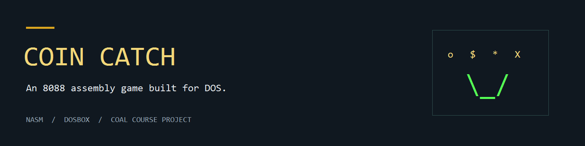
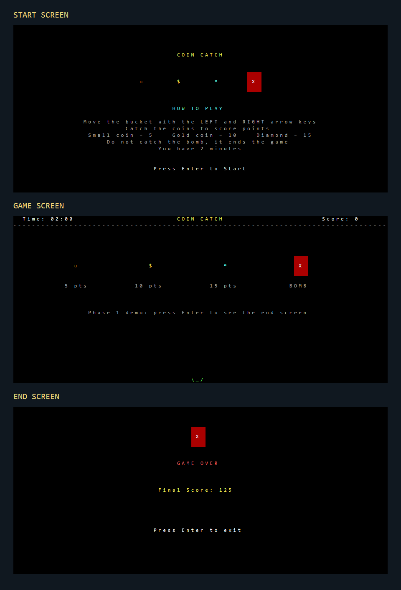

# Coin Catch

**An Intel 8088 assembly game developed for the Computer Organization and Assembly Language course.**

Coin Catch is built around a simple goal. Move a bucket, collect coins, and avoid bombs. Written in **NASM** as a **DOS `.COM` program**, the project uses an **80 × 25 text display** and draws directly into video memory.

**Current release — Phase 1 interface demo**

The current version includes a start screen, a static game screen, and an end screen. Press **Enter** to move through the demo. Movement, falling objects, collision detection, and the countdown are planned for Phase 2.

## Preview



*Rendered from the current source layouts using a desktop monospace font. DOSBox font appearance may differ.*

## Phase 1 features

- **Start screen** with the game title, controls, object values, and an Enter prompt.
- **Game display** with a static `02:00` timer and a score of `0` at the top right.
- **Five object placeholders**, each stored in a 3 × 3 character space.
- **End screen** with `GAME OVER` and a demonstration final score of `125`.
- **Keyboard flow** that accepts Enter to advance and ignores other keys.
- **Screen cleanup** between screens and before returning to DOS.

## Objects

| Object | Placeholder | Intended role |
|---|---|---|
| Small coin | `o` | Adds **5 points** |
| Gold coin | `$` | Adds **10 points** |
| Diamond | `*` | Adds **15 points** |
| Bomb | `X` | Ends the game when caught |
| Bucket | `\_/` | Collects falling objects |

**Phase 1 uses static placeholders.** The point values describe the planned gameplay. The final score of `125` is a demo value used to demonstrate number printing.

## Build

Install **NASM** and **DOSBox**. Run the following from the repository root with NASM available on your command path.

```sh
nasm src/game.asm -o build/game.com -l build/game.lst
```

The build produces `build/game.com` and an assembly listing at `build/game.lst`.

Run the course instruction checker using Bash.

```sh
bash tools/check_rules.sh
```

A successful check prints `OK`.

## Run in DOSBox

Mount the repository's `build` folder as a DOS drive. Replace the example path with the absolute path to your local build folder.

```dos
mount c "D:\path\to\falling-object-collection-game\build"
c:
game.com
```

| Screen | Action | Result |
|---|---|---|
| Start screen | Press **Enter** | Show the game screen |
| Game screen | Press **Enter** | Show GAME OVER and final score `125` |
| End screen | Press **Enter** | Clear the screen and return to DOS |

The arrow keys described on the start screen are reserved for Phase 2 gameplay.

## Assembly concepts

The implementation follows **Belal Hashmi's CS401 lecture notes**, using the concepts covered in chapters 1–8.

- **Direct video memory access** through segment `0xB800`.
- **Stack parameters** and register preservation in subroutines.
- **Word tables** for text positions, colors, and object locations.
- **String instructions** including `LODSB`, `STOSW`, and `REP STOSW`.
- **Division and ASCII conversion** for decimal scores and `mm:ss` time formatting.
- **BIOS keyboard input** through `INT 16h` and DOS termination through `INT 21h`.

All game code lives in **one assembly source file**.

## Repository layout

| Path | Contents |
|---|---|
| `src/game.asm` | Program data, drawing routines, and screen flow |
| `build/` | Generated executable and listing, excluded from version control |
| `docs/PROJECT_SPEC.md` | Course requirements and phase scope |
| `docs/PHASE1_PLAN.md` | Implementation steps and acceptance checklist |
| `docs/ASSEMBLY_RULES.md` | Instruction limits and coding conventions |
| `docs/reference/book.txt` | Course reference text |
| `tools/check_rules.sh` | Assembly instruction checker |
| `tools/commit-msg` | Commit message validation hook |

## Project status

| Milestone | Status |
|---|---|
| **Phase 1 — interface and object display** | Complete |
| **Phase 2 — playable game** | Planned |

Phase 2 covers left and right bucket movement, falling objects, collision detection, live scoring, and a two-minute countdown.

## Team

| Student | Roll number |
|---|---|
| **Muhammad Ibrahim** | `25L-0716` |
| **Muhammad Hassaan Sajid** | `25L-2555` |
